

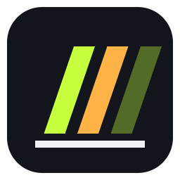

# dbDash – dannerbam Dash

[Deutsch](README.md) · **English**

**Free overlays for iRacing, ACC & more – made by a sim racer for sim racers.**

Relative · Standings · Dashboard · Radar · Inputs · Delta – easy on your FPS and also usable as OBS browser sources.

[**⬇ Download**](../../releases/latest) · [Features](#features) · [Installation](#installation) · [Usage](#usage) · [Stream Deck](#stream-deck--simhub) · [OBS](#obs--streaming)

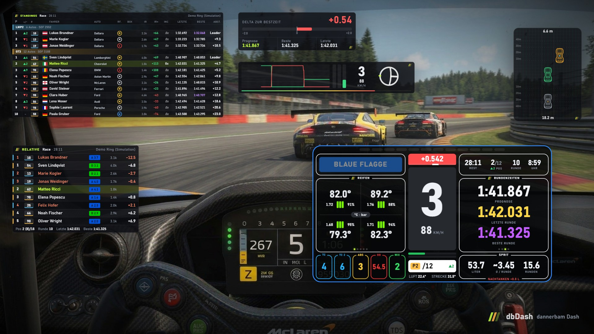

The screenshots show the German interface – switch to English in the settings window (*Language*).

## Why dbDash?

- 🆓 **Free** – no subscription, no ads, no account.
- 🚀 **Easy on your FPS** – only redraws what actually changes and always gives iRacing priority for CPU time
  (about **1 % CPU** with all six overlays in our test).
- 🎛️ **Control it from your wheel** – switch dashboard pages with a wheel button, button box, key or Stream Deck.
- 📺 **For streamers** – every overlay is also available as an OBS browser source.
- 🌍 **German and English** – picks your Windows language automatically, switchable at any time.
- 🎮 **Several games** – iRacing and Assetto Corsa Competizione, more to come; dbDash detects the running game itself.
- 🧪 **Try it right away** – demo mode shows a simulated multi-class race, no game needed.

## Supported games

| Game | Status | Notes |
| --- | --- | --- |
| **iRacing** | complete | all features incl. iRating, license, SOF, incidents, damage |
| **Assetto Corsa Competizione** | new – feedback welcome | no iRating, license, incidents or damage display (ACC doesn't provide them); tyres: core temperature and pressure |
| AC, LMU, Automobilista 2, RaceRoom | planned | |

**Setting up ACC:** for standings, relative and radar with all opponents, dbDash needs ACC's *broadcasting interface*.
The first time you run ACC, the settings window shows a **“Set up”** button – it enters port 9000 in
`Documents\Assetto Corsa Competizione\Config\broadcasting.json` (the old file is kept as `.bak`). Then restart ACC
once. Without this interface dbDash only shows your own car.
Turn **fullscreen off** in ACC (borderless window), otherwise Windows can't draw the overlays on top.

## Features

### Dashboard

The big driver display: shift lights, gear, speed, throttle and brake bars, delta to your best lap, position with places
gained or lost, time left, lap, clock, flags (blue, yellow, white, checkered …) with pit limiter warning,
TC / TC 2 / ABS / brake bias / engine map, and fuel including how much to refuel to reach the finish.

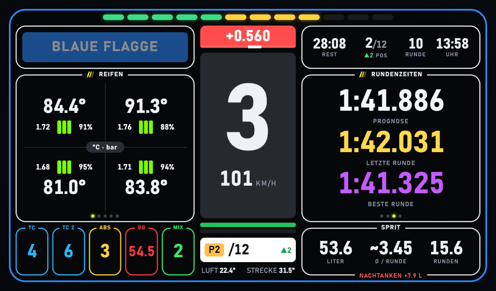

Left and right are two panels with **switchable pages** – for each page choose **left, right or off**:

| Page | Shows |
| --- | --- |
| **Tyres** | temperature inside / middle / outside, pressure, wear |
| **Engine** | water, oil, oil and fuel pressure, battery, RPM |
| **Fuel strategy** | average usage, range, laps to go, fuel to the finish, stops needed |
| **Relative – overall / class** | 3 cars ahead of and behind you |
| **Gaps – overall / class** | car ahead and behind with trend per lap (▲/▼, green = good for you) and their lap times |
| **Lap times** | prediction for the current lap, last and best lap |
| **Damage** | GT3 as a technical drawing: green = all good, orange = light damage, red = required repair; engine warnings and tyre wear |

<table>
  <tr>
    <td>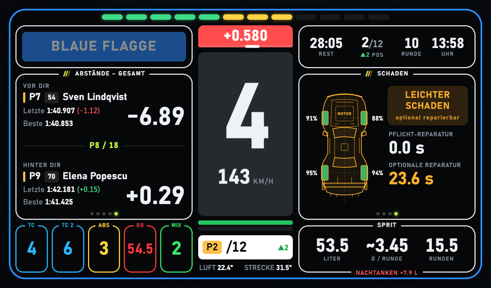</td>
    <td>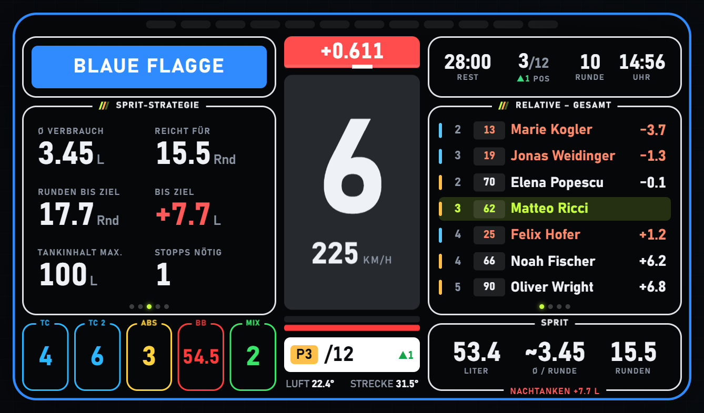</td>
  </tr>
  <tr>
    <td align="center">Gaps with trend · damage as a blueprint</td>
    <td align="center">Fuel strategy · relative</td>
  </tr>
</table>

### Relative

The drivers directly ahead of and behind you on track with time gap, license and iRating.
**“−” = ahead of you, “+” = behind you.** Orange = a lap ahead of you (lapping you), blue = a lap behind you.

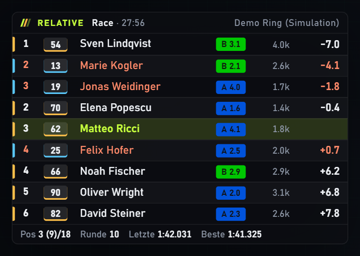

### Standings

Results by class with SOF. Columns: **positions +/−** since the start, **grid position**, car number, **country flag**,
**car brand**, **tyres** (current compound: S red, M yellow, H white, I green, W blue), **pit** (who is in the pits
right now, otherwise number of stops), license, iRating, **iRating prediction** (if the race ended now), **incidents**,
last / best lap, gap. Purple = fastest lap in the class.

Every column can be **switched on or off and moved freely** in the settings window – drag it with the mouse or use ▲ / ▼.

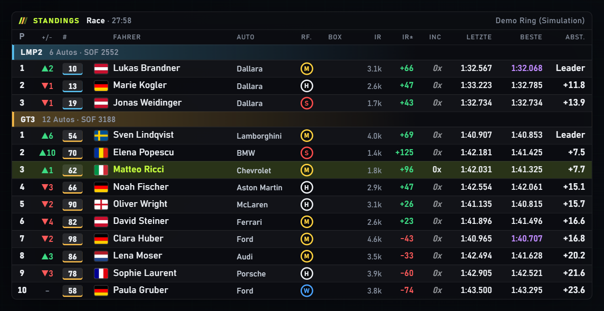

### Radar & Inputs / Delta

<table>
  <tr>
    <td width="34%" valign="top">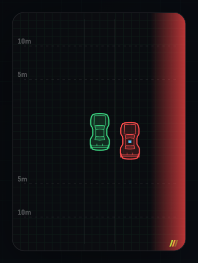</td>
    <td valign="top">

**Radar (ghost)** – top-down view of the cars ahead of, behind and next to you, drawn as GT3 blueprints
(your car green, class colour on the roof). Red = next to you, orange = gap below 7 m.

- range **1–80 m**, measured as the gap from bumper to bumper
- only appears while a car is within range and **disappears instantly** again
- stays off during **qualifying**

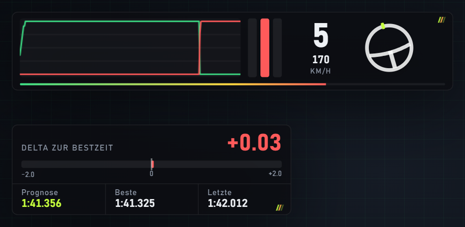

**Inputs** – throttle/brake trace, pedal bars, gear, speed, steering wheel.
**Delta** – delta to your best lap with bar, lap time prediction, best and last lap.

</td>
  </tr>
</table>

All overlays hide automatically while the engine is not running (can be turned off).

## Installation

1. [**Download the latest version**](../../releases/latest) and unzip it
   (e.g. to `C:\Program Files\dbDash` or your desktop).
2. Start **`dbDash.exe`**. On first start, **demo mode** runs a simulated race so you can see everything right away.
3. For real data: turn **demo mode off** in the settings window and start iRacing or ACC.

> [!IMPORTANT]
> Run the game in a **borderless window**: in iRacing set *Options → Graphics* to **Borderless Window**, in ACC turn
> fullscreen off. In exclusive fullscreen, Windows can't show
> windows on top of the game.

> [!NOTE]
> Windows SmartScreen may warn you on first start because the file isn't signed:
> “More info” → “Run anyway”.

## Usage

| Action | How |
| --- | --- |
| Open settings | click the dbDash icon in the taskbar notification area |
| Move overlays | `Alt+Shift+E` (or the switch in the settings window), drag the overlay with the mouse, `Alt+Shift+E` again |
| Show / hide all | `Alt+Shift+H` |
| Switch dashboard left / right | `Alt+Shift+←` / `Alt+Shift+→` (going back can be assigned freely) |
| Quit | right-click the icon → Quit |

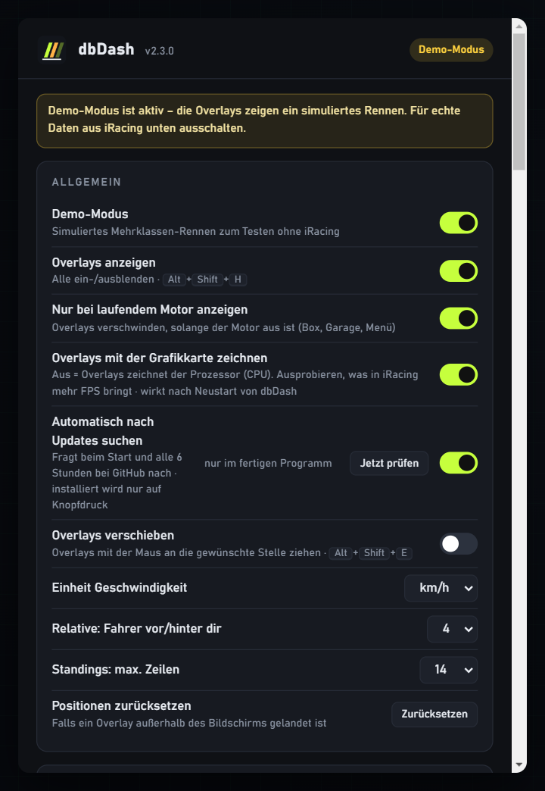

In the **settings window** you switch each overlay on or off and set its **size** and **background opacity**. You also
choose the language, the standings columns, the dashboard pages (left / right / off), the radar range and the unit
(km/h or mph). Positions and settings are saved (`%APPDATA%\dbDash\settings.json`).

**Keys & wheel buttons:** every action can be reassigned: click “Assign” and press a key or a button on your wheel /
button box. Each action takes one key and one wheel button. Wheel buttons also work while iRacing is in the foreground
(up to 16 devices, 32 buttons each + coolie hat).

> [!TIP]
> A **keyboard** key assigned here no longer reaches iRacing – wheel buttons do. For Stream Deck and SimHub it's best
> to use **F13–F24** (no keyboard has those).

**Draw overlays with the graphics card:** when switched off, the processor draws the overlays. Which gives more FPS in
iRacing depends on your PC – just try both (takes effect after restarting dbDash).

 

## Updates

dbDash checks GitHub for a new version at start and every 6 hours. If there is one, the settings window shows a notice
– **“Install now”** downloads the update, closes dbDash briefly and starts the new version. It **never installs on its
own** (no restart in the middle of a race), and your settings are kept. If dbDash lives in a protected folder like
`C:\Program Files`, Windows asks once for administrator rights. The check can be turned off in the settings window.

## Languages

dbDash speaks **German** and **English** and follows your Windows language automatically; you can switch at any time
in the settings window (*Language*). All texts are in `web/lang/<language>.json` (`de.json`, `en.json`).

**Want dbDash in your language?** Copy `en.json`, translate the texts (keep the keys and `{placeholders}` as they are)
and send the file to me – for example as a GitHub issue. I'll include it in the next version. Because of the license,
please don't publish translated versions yourself.

## Stream Deck & SimHub

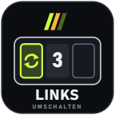 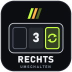

Matching key images for switching the dashboard are in the `Grafiken` folder (PNG in 72, 144, 256, 512 px and SVG).

- **Stream Deck without a plugin:** assign a key from **F13–F24** to the “Hotkey” action and assign that key in dbDash
  under “Keys & wheel buttons”.
- **Stream Deck with the “Web Requests” plugin (BarRaider):** let it call an address, e.g.
  `http://127.0.0.1:8182/api/action/dashLeft`, or open a page directly: `http://127.0.0.1:8182/api/page/gapClass`.
  All addresses are listed for copying in the settings window, the list is also at `http://127.0.0.1:8182/api/list`.
- **SimHub:** give a button in a dashboard (Dash Studio) the image and let it send a key from **F13–F24**; assign that
  key in dbDash.

## OBS / Streaming

Every overlay is also a web page while dbDash is running. In OBS: *Add source → Browser*, paste the address and set the
size:

| Overlay | Address | Size (approx.) |
| --- | --- | --- |
| Relative | `http://127.0.0.1:8182/relative.html` | 430 × 300 |
| Standings | `http://127.0.0.1:8182/standings.html` | 640 × 460 |
| Inputs | `http://127.0.0.1:8182/inputs.html` | 600 × 110 |
| Delta | `http://127.0.0.1:8182/delta.html` | 380 × 130 |
| Dashboard | `http://127.0.0.1:8182/dash.html` | 860 × 500 |
| Radar | `http://127.0.0.1:8182/radar.html` | 220 × 300 |

Sizes depend on the number of rows and columns – adjust if needed.

## Good to know

dbDash only shows what the games provide through their official interfaces. For iRacing (iRacing SDK):

- **Other drivers' incidents** are kept secret by iRacing during the session. dbDash therefore counts their off-tracks
  (1x each) and shows this estimate *in italics and dimmed*. Contacts (2x / 4x) are not included.
  Your own incidents are always exact.
- **Damage:** iRacing doesn't report *which* part is damaged – only the repair times. The car graphic therefore shows the
  damage level for the whole car.
- **Radar:** iRacing provides no lateral position, only the distance on track and the spotter's “car left / right”.
  Cars ahead / behind are shown in the middle, cars next to you on the side the spotter reports.
- **iRating prediction:** uses the formula worked out by the community and is an estimate (per class, races only).
- Values a car doesn't have (e.g. TC) show as “–”. Depending on the car, iRacing only updates tyre values at pit stops.

## Customising

The overlays are plain HTML, CSS and JavaScript files in the `resources\web` folder and may be adapted for your own use
(please don't share modified versions – see license). Changes show up after restarting dbDash. The data arrives via
WebSocket (`ws://127.0.0.1:8182/ws`) as JSON – see `common.js` (`PW.onState(...)`).

## Building it yourself

Requirement: **Node.js 22 or newer** (LTS from [nodejs.org](https://nodejs.org)). Then in the source folder:

| Command | What it does |
| --- | --- |
| `npm install` | downloads all dependencies (once, about 200 MB) |
| `npm test` | checks the iRacing and ACC readers, wheel buttons, gaps, times, incidents, radar, standings columns and translations |
| `npm start` | runs dbDash straight from the source code |
| `npm run build` | builds the finished program: `dist\dbDash\dbDash.exe` plus a ZIP to share |
| `npm run screenshots` | regenerates the images on this page (`docs/img/`) |
| `npm run video` | records the introduction video (`video/out/`, needs [ffmpeg](https://ffmpeg.org)) |
| `npm run icons` | generates the program icon and Stream Deck images from the SVG templates |

**Under the hood:** Electron (Chromium + Node.js). Telemetry is read directly from the shared memory of the official
iRacing SDK (`Local\IRSDKMemMapFileName`) or from ACC's shared memory (`acpmf_*`) and the ACC broadcasting interface (UDP), via
koffi and the Win32 API. `acc.js` translates ACC into the same data format. Source in `src/`: `main.js` (windows, web server,
languages), `irsdk.js` (SDK reader), `state.js` (calculations), `fuel.js` (fuel), `race.js` (grid, pit stops, incidents),
`joystick.js` (wheel buttons), `updater.js` (updates via GitHub releases), `demo.js` (simulation).

## License

Copyright © 2026 Johann Danner. dbDash is licensed under
**[CC BY-NC-ND 4.0](https://creativecommons.org/licenses/by-nc-nd/4.0/)**
(Attribution – NonCommercial – NoDerivatives):

- ✅ Use it for free and share it **unchanged** (keeping the name, author and license notice).
- ✅ Adapt it for your own personal use.
- ❌ Share or publish modified versions.
- ❌ Sell it or use it commercially.

Details: [`LICENSE`](LICENSE). Bundled third-party components (Electron, Chromium, koffi, ws, js-yaml, country flags from
[flag-icons](https://github.com/lipis/flag-icons)) keep their own licenses – see `DRITTANBIETER-LIZENZEN.txt` in the
finished program.

dbDash is an independent project and not affiliated with iRacing.com Motorsport Simulations, Kunos Simulazioni or RaceLabs.
